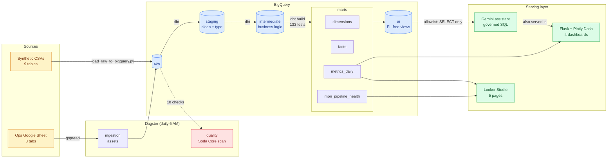
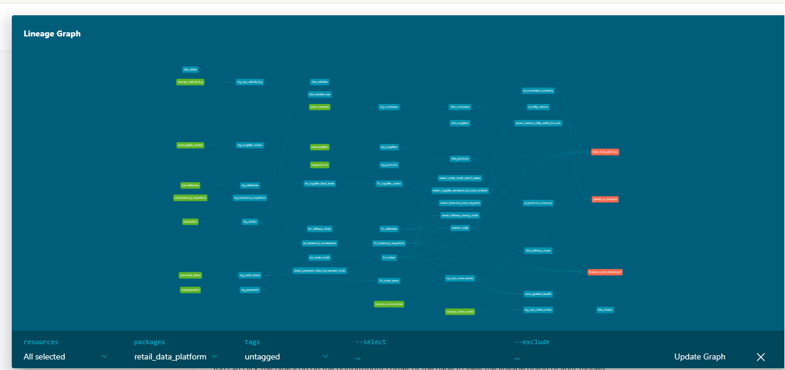
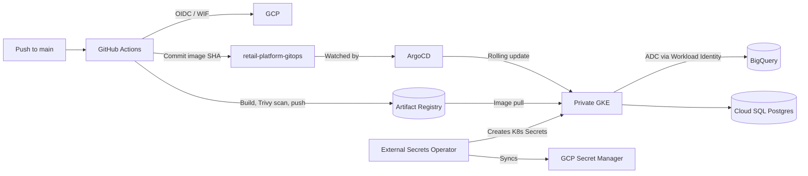

# Retail Data Platform

An end-to-end analytics engineering platform for an online supermarket. Ingests
raw operational data from synthetic CSVs and an operations Google Sheet, models
it into a trusted star schema in BigQuery, defines core metrics once, and serves
them through a Flask + Plotly Dash BI platform, Looker Studio, and a governed
AI assistant. The platform runs on a private GKE cluster, provisioned with
Terraform and deployed through ArgoCD (GitOps), with keyless authentication
end to end.

Two real data-quality incidents are documented in
[docs/data_quality_log.md](docs/data_quality_log.md): an on-time delivery rate
silently reporting 100%, and a duplicate `zone_id` in the ops source sheet.
Both were diagnosed, fixed, and covered by regression tests.

## Related Repositories

This platform uses a multi-repo architecture:

| Repository | Purpose |
|---|---|
| **RetailDataPlatform** (this repo) | Application code: Python, dbt, Flask, Dagster, Soda |
| [retail-platform-infrastructure](https://github.com/benkivuva/retail-platform-infrastructure) | Terraform for GCP (GKE, Cloud SQL, BigQuery, IAM, Workload Identity) and cluster bootstrap (ArgoCD, External Secrets, Kyverno, Prometheus/Grafana) |
| [retail-platform-gitops](https://github.com/benkivuva/retail-platform-gitops) | Kubernetes manifests reconciled by ArgoCD |

## Architecture

### Data flow

**How to read it**

| Stage | What happens |
|---|---|
| **Sources** | Synthetic CSVs and the human-edited ops sheet enter as-is. Raw stays raw. |
| **raw → staging** | dbt cleans, types, and de-duplicates (this is where the two logged data-quality incidents were fixed). |
| **intermediate → marts** | Reusable business logic feeds a star schema plus `metrics_daily`, the single definition of every metric. |
| **Quality gates** | Soda scans `raw`; dbt tests gate every downstream model. A failure in either fails the pipeline. |
| **ai** | PII-free, read-only views. The only data the AI assistant can touch. |
| **Serving** | The Flask platform, Looker Studio, and the AI assistant all read `marts` or `ai`, never `raw`, `staging`, or `intermediate`. |

Lineage (models plus downstream consumers via dbt exposures):

### Delivery flow

## Stack

- **Sources:** Synthetic CSVs + Google Sheets (via `gspread`)
- **Warehouse:** Google BigQuery
- **Transformation:** dbt Core with `dbt-bigquery`
- **Orchestration:** Dagster (daily schedule, asset-level observability)
- **Data Quality:** dbt tests (in-warehouse) + Soda Core (anomaly detection)
- **Language:** SQL, Python
- **Environment:** `uv` for Python and dependency management
- **BI (hosted):** Looker Studio
- **BI (application):** Flask 3 + Plotly Dash 4, served by gunicorn
- **App database:** Cloud SQL (Postgres) via `psycopg2-binary`
- **Auth:** Flask-Login with role-based access (admin / analyst / viewer)
- **AI:** Google Gemini with a governed SQL tool
- **Containerisation:** Docker (two multi-stage images, non-root user)
- **Cloud authentication:** Application Default Credentials; Workload Identity on GKE and Workload Identity Federation in CI. No JSON service account keys.
- **CI/CD:** GitHub Actions (two workflows: pipeline + platform)
- **Deployment:** ArgoCD (GitOps, ApplicationSet pattern) on private GKE
- **Secrets:** External Secrets Operator syncing GCP Secret Manager into Kubernetes
- **Policy:** Kyverno (non-root enforcement)
- **Observability:** Prometheus + Grafana, plus Dagster UI
- **Version control:** Git, feature-branch workflow

## Datasets

| Dataset | Purpose |
|---|---|
| `raw` | Source CSVs and ops Google Sheets loaded as-is |
| `staging` | Cleaned and typed source data |
| `intermediate` | Business logic reused by marts |
| `marts` | Star schema and metrics |
| `ai` | PII-free, read-only views for AI assistants |

## Sources

Two source systems feed the platform.

**Synthetic CSVs** — generated by `data/scripts/generate_raw_data.py` to
simulate e-commerce, delivery, inventory, and supplier systems. Loaded by
`data/scripts/load_raw_to_bigquery.py`. Nine tables: orders, order items,
payments, deliveries, inventory snapshots, customers, products, suppliers,
supplier orders.

**Ops Google Sheet** — a human-edited operations tracker with three tabs:

| Tab | Grain | Loaded to |
|---|---|---|
| Zone Master | one row per delivery zone | `raw.ops_zone_master` |
| Driver Roster | one row per driver-day assignment | `raw.ops_driver_roster` |
| Vehicle Log | one row per service event | `raw.ops_vehicle_log` |

Loaded by `data/scripts/load_sheets_to_bigquery.py` using the `gspread` library.
The sheet is deliberately messy: mixed-case county spellings, three date formats
in the same column, phone numbers in three formats, free-text vehicle
descriptions, duplicate rows, and blank rows used as section separators.
Cleaning happens in dbt staging models, not in the loader — raw stays raw.

The full source profile, including known quality issues and handling, is in
[docs/source_assessment.md](docs/source_assessment.md).

## Core Metrics

All metrics are defined once in `marts.metrics_daily`. See
[docs/metric_dictionary.md](docs/metric_dictionary.md) for definitions,
formulas, owners, and the change process.

## Data Quality

Two complementary layers:

**dbt tests (in-warehouse)** — 133 automated tests covering:

- Primary and foreign key checks
- Custom business rules (order reconciliation, delivery timing, inventory
  bounds, payment limits)
- Metric bounds on `metrics_daily`
- Enriched dimension tests for `dim_drivers`, `dim_vehicles`, and
  `dim_delivery_zones`

**Soda Core (raw-layer anomaly detection)** — 10 checks on the raw dataset:

- Row count is never zero
- Duplicate and missing IDs on primary keys
- Negative financial values (revenue, discount, quantity)
- Row-count thresholds for anomaly detection

The Soda scan runs as a downstream Dagster asset; a failed scan fails the
pipeline. See `soda/checks.yml`.

Two source-side data-quality incidents were caught by tests and fixed in
staging:

- On-time delivery rate silently reporting 100% (wrong denominator).
- Duplicate `zone_id` in the ops sheet (same zone, two spellings).

Both are documented in [docs/data_quality_log.md](docs/data_quality_log.md).

## Monitoring & Observability

Four layers cover pipeline and platform health:

- **Dagster UI** — per-asset run status, timing, and error logs for every dbt
  build and Soda scan
- **Soda Core** — anomaly detection on the raw layer
- **Looker Studio (Pipeline Health page)** — freshness lag, row counts, and
  latest metric date, read from `marts.mon_pipeline_health`
- **Prometheus + Grafana** — scrape metrics from the Flask and Dagster pods in
  the cluster (installed by the infrastructure repo)

## Looker Studio Dashboard

A five-page Looker Studio dashboard reads directly from `marts`:

- **Operations** — orders, deliveries, on-time rate, stockouts
- **Commercial** — GMV, net revenue, AOV, units
- **Finance** — revenue, discounts, delivery fees, gross margin
- **Customers** — segments, acquisition channels
- **Pipeline Health** — freshness lag, row counts, latest metric date

Link: [dashboards/dashboard_link.md](dashboards/dashboard_link.md)

## BI Platform

A Flask + Plotly Dash application in `platform/` provides a code-first BI
surface on top of the same metrics:

- **Four dashboards** — Operations, Commercial, Finance, Customers
- **AI chat** at `/ai/chat` — plain-English queries against the governed
  assistant in `ai/`
- **Authentication** — session-based via Flask-Login; role-based access
  (admin, analyst, viewer)
- **Session hardening** — CSRF protection, HTTPOnly + SameSite cookies,
  8-hour session lifetime, open-redirect protection on `next=`
- **Caching** — 5-minute TTL on BigQuery queries to keep the UI responsive
- **Containerised** — multi-stage image (`Dockerfile.flask`), non-root user, gunicorn
- **Tested** — pytest suite covering the auth flow and the AI SQL allowlist

Data access is centralised in `platform/app/queries/bigquery.py`. The platform
reads `marts.*` and `ai.*` only — never `raw`, `staging`, or `intermediate`,
and never writes.

### Application database

In Kubernetes, Flask connects to a private **Cloud SQL (Postgres)** instance
using the `psycopg2-binary` driver. `DATABASE_URL` is never passed by hand: the
External Secrets Operator pulls it from GCP Secret Manager and creates a
Kubernetes Secret that is injected into the pod.

### Run locally

Authenticate once with Application Default Credentials (no key files):

    gcloud auth application-default login

Then start the app and seed demo users (admin@example.com / admin123,
analyst@..., viewer@...):

    uv run python platform/run.py
    uv run python platform/seed_users.py

For local development, set `DATABASE_URL` in `platform/.env` (a local SQLite or
Postgres URL is fine).

### Run in Docker (local testing)

The platform ships as two images, built from separate Dockerfiles:

| File | Image |
|---|---|
| `Dockerfile.flask` | Flask + Dash BI platform |
| `Dockerfile.dagster` | Dagster orchestrator (webserver + daemon) |

    docker build -f Dockerfile.flask -t retail-platform-flask .
    docker build -f Dockerfile.dagster -t retail-platform-dagster .

Containers authenticate through ADC; no service account JSON is mounted. To run
locally, make your own `gcloud auth application-default login` credentials
available read-only to the container:

    docker run --rm -p 8080:8080 \
      -v "$HOME/.config/gcloud:/root/.config/gcloud:ro" \
      -e GCP_PROJECT=<your-project> \
      -e SECRET_KEY=<random-string> \
      -e GEMINI_API_KEY=<your-key> \
      -e DATABASE_URL=<local-database-url> \
      retail-platform-flask

> Adjust the mount target if your image runs as a non-root user (for example
> `/home/<user>/.config/gcloud`). In GKE no mount is needed: pods use Workload
> Identity.

## Orchestration

Dagster orchestrates the full pipeline as an asset graph across three groups:

- **ingestion** — loads the ops Google Sheet into `raw.ops_*`
- **dbt** — one asset per dbt model (30+ models, run via `dbt build`)
- **quality** — Soda Core scan on the raw layer, downstream of dbt

A daily 6 AM schedule triggers the run. dbt tests halt downstream models on
failure, and a failed Soda scan fails the pipeline. Every execution is tracked
in the Dagster UI with per-asset status, timing, and error logs.

Successful materialization of all assets:

Run locally:

    uv run dagster dev -f orchestration/definitions.py

**In Kubernetes**, Dagster runs from `Dockerfile.dagster` and uses its default
SQLite storage, with an `emptyDir` volume mounted at `/app/.dagster`. Run
history is therefore ephemeral and resets when the pod restarts. The
`psycopg2-binary` and `dagster-postgres` dependencies are declared in
`pyproject.toml` so Postgres-backed storage can be adopted later.

## Deployment

The platform is **not** deployed with `docker run`. Deployment is fully GitOps:

1. A push to `main` triggers `platform_ci.yml`.
2. CI builds the images, scans them with Trivy, and pushes them to
   **GCP Artifact Registry**.
3. CI commits the new image Git SHA to the
   [`retail-platform-gitops`](https://github.com/benkivuva/retail-platform-gitops)
   repository.
4. **ArgoCD** (ApplicationSet pattern) detects the change and performs a rolling
   update on the private GKE cluster.

Secrets come from GCP Secret Manager through the External Secrets Operator.
Pods reach BigQuery through Workload Identity, so there are no keys in the
cluster. The cluster and its tooling are provisioned from
[retail-platform-infrastructure](https://github.com/benkivuva/retail-platform-infrastructure).

### Security controls

- **Non-root pods:** a Kyverno policy requires containers to run as non-root
  (`runAsUser: 1000`); pods that violate it are rejected.
- **Keyless auth:** Application Default Credentials locally, Workload Identity
  on GKE, Workload Identity Federation in CI. No JSON keys exist.
- **Image scanning:** Trivy fails the build on CRITICAL or HIGH CVEs.
- **Private networking:** private GKE nodes and a private Cloud SQL instance.
- **Secrets management:** values live in Secret Manager, never in Git.

## AI Assistant

A governed AI assistant lets users ask business questions in plain English.
The model (`gemini-3.8-flash`) reads `ai/context.md` as system instructions,
generates a BigQuery SQL query, and calls a `run_sql` tool. Every query passes
an allowlist that:

- Permits only SELECT statements
- Blocks multiple statements
- Restricts access to three PII-free views: `ai_daily_metrics`,
  `ai_customers_summary`, `ai_products_summary`

The assistant is available two ways: as a CLI (`ai/ask.py`) and as a web page
inside the BI platform (`/ai/chat`). The allowlist is covered by unit tests in
`platform/tests/test_ai_allowlist.py`, run on every push. The assistant itself
is not exercised in CI because it requires an API key and live network access.

See [ai/context.md](ai/context.md) and [ai/ask.py](ai/ask.py).

## CI/CD

Two GitHub Actions workflows run on every push to `main` and every pull request.
Both authenticate to GCP with **Workload Identity Federation** via GitHub OIDC
(`google-github-actions/auth@v2`). There is no `GCP_SA_KEY` secret.

- **`dbt_ci.yml`** — authenticates via WIF, runs `dbt debug`, `dbt build`, and
  the pipeline unit tests.
- **`platform_ci.yml`** — installs dependencies, runs the platform pytest suite
  (auth flow, AI SQL allowlist), builds both Docker images, scans them with
  **Trivy** (failing on CRITICAL/HIGH CVEs), pushes them to Artifact Registry,
  and uses a `GITOPS_PAT` to commit the new image Git SHA to
  `retail-platform-gitops`, which triggers the ArgoCD rollout.

Failed tests, a failed Trivy scan, or a failed image build block the merge.

## Getting Started

### Prerequisites

- `uv`, `gcloud`, and Python 3.12
- A GCP project with datasets `raw`, `staging`, `intermediate`, `marts`, `ai`
  (the `ai` dataset is created by dbt on first build, or manually with
  `bq mk --location=US ai`)
- BigQuery Data Editor and Job User roles on your user account
- Application Default Credentials. **Run this before any `dbt` or `soda` command:**

      gcloud auth application-default login

### Setup

1. Install the prerequisites above and authenticate with ADC.
2. Review `dbt/profiles.yml`. It is committed to the repo and uses
   `method: oauth`, so there is nothing to put in `~/.dbt/`. Soda's
   `configuration.yml` uses `oauth` as well.
3. Generate synthetic data and load it from the repository root:

       uv run python data/scripts/generate_raw_data.py
       uv run python data/scripts/load_raw_to_bigquery.py

4. Optional — load the ops Google Sheet (second source):

    - Share the sheet with the identity you authenticate as (your user account
      locally, the pipeline's Workload Identity service account in the cluster)
      as Viewer.
    - Enable the Google Sheets and Drive APIs on the GCP project.
    - Run:

          uv run python data/scripts/load_sheets_to_bigquery.py

5. Build the whole warehouse:

       cd dbt
       uv run dbt build --full-refresh

6. Generate and view dbt docs:

       uv run dbt docs generate
       uv run dbt docs serve

7. Optional — run the pipeline under Dagster:

       uv run dagster dev -f orchestration/definitions.py

8. Optional — run Soda checks standalone:

       uv run soda scan -d retail_bigquery -c soda/configuration.yml soda/checks.yml

9. Optional — run the BI platform locally (requires `platform/.env`):

       uv run python platform/run.py
       uv run python platform/seed_users.py

10. Optional — run the CLI AI assistant:

        export GEMINI_API_KEY="your-key"        # PowerShell: $env:GEMINI_API_KEY = "your-key"
        uv run python ai/ask.py

## Documentation

- [Architecture](docs/architecture.md)
- [Metric Dictionary](docs/metric_dictionary.md)
- [Data Catalogue](docs/data_catalogue.md)
- [Source Assessment](docs/source_assessment.md)
- [Runbook](docs/runbook.md)
- [Data Quality Log](docs/data_quality_log.md)
- [Cost Report](docs/cost_report.md)
- [Roadmap](docs/roadmap.md)
- [Dashboard](dashboards/dashboard_link.md)
- [AI Context](ai/context.md)

## Repository Layout

    RetailDataPlatform/
    ├── .github/
    │   └── workflows/
    │       ├── dbt_ci.yml           # Pipeline: WIF auth, dbt build + tests
    │       └── platform_ci.yml      # Platform: pytest, build, Trivy, push, GitOps update
    ├── ai/
    │   ├── ask.py                   # Gemini assistant with SQL allowlist
    │   └── context.md               # definitions and query rules for the AI
    ├── dashboards/
    │   └── dashboard_link.md        # Looker Studio dashboard
    ├── data/
    │   ├── raw/                     # CSVs (gitignored)
    │   └── scripts/
    │       ├── generate_raw_data.py
    │       ├── load_raw_to_bigquery.py
    │       └── load_sheets_to_bigquery.py   # ops Google Sheet loader
    ├── dbt/
    │   ├── macros/                  # generate_schema_name
    │   ├── models/
    │   │   ├── staging/             # incl. stg_ops_*
    │   │   ├── intermediate/
    │   │   ├── marts/               # dims (incl. dim_vehicles), facts,
    │   │   │                        # metrics_daily, mon_pipeline_health
    │   │   └── ai/
    │   ├── tests/                   # custom singular tests
    │   └── profiles.yml             # committed; method: oauth (ADC)
    ├── docs/
    ├── orchestration/
    │   └── definitions.py           # Dagster: ingestion + dbt + Soda
    ├── platform/
    │   ├── app/
    │   │   ├── auth/                # login, role model, session hardening
    │   │   ├── ai/                  # chat page wired to governed assistant
    │   │   ├── dashboards/          # Operations, Commercial, Finance, Customers
    │   │   ├── queries/             # BigQuery access layer
    │   │   └── templates/           # login + chat pages
    │   ├── tests/                   # pytest for auth + AI allowlist
    │   ├── run.py                   # dev entry point
    │   └── seed_users.py            # creates demo users
    ├── soda/
    │   ├── configuration.yml        # Soda BigQuery connection (oauth)
    │   └── checks.yml               # 10 anomaly + validation checks
    ├── Dockerfile.flask             # Flask + Dash image: multi-stage, non-root, gunicorn
    ├── Dockerfile.dagster           # Dagster image: multi-stage, non-root
    ├── wsgi.py                      # production entry point
    └── pyproject.toml